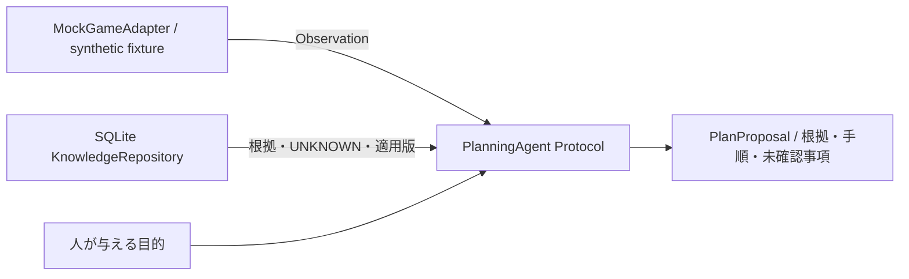
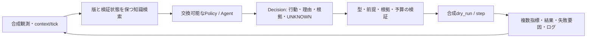

# アダプタ・AI設計と次Phase計画

**現状：Phase 4AのPC/モデル/費用調査と設計を完了。実装はPhase 3の0.3.0を維持しています。以下の過去計画は履歴として保持し、末尾のPhase 4B具体計画を現在の推奨案とします。**

Phase 0時点では実ゲームへ接続せず、AIモデルも呼び出しません。将来のONI観測層とAI判断層の境界を、Python Protocolと不変のデータクラスで定義します。

## インターフェース

実装：[interfaces.py](../src/oni_ai/interfaces.py)、[adapters.py](../src/oni_ai/adapters.py)。

| 境界 | 現在の契約 | 将来の実装要件 |
| --- | --- | --- |
| ReadOnlyGameAdapter | read_resource(uri) -> Observation | 実行口と別権限、監査済みURI/引数のallowlist |
| Observation | resource_uri、payload_json、observed_at、game_version、dlc_scope、context_id、provenance | セーブ/世界/観測時点を関連づけ、版不明や鮮度不明を保持 |
| KnowledgeSearch | search(query, game_version, dlc_scope, limit) | AIへ根拠とstatusを保持した結果を返す |
| PlanningAgent | propose(objective, observations, knowledge) -> PlanProposal | 判断・計画・改善はAI自身に任せる |
| PlanProposal | objective、observation_context、rationale、steps、unknowns | 実行権限を含まない提案データ |

現在のMockGameAdapterはメモリ内のfixtureを深いコピーで保持し、manifest/status/defsの完全一致URIだけを受け付けます。URI queryやHTTP URLを拒否します。数値を実測したように見せず、provenanceにMOCK_SYNTHETIC_NOT_GAME_DATA、時刻・版・DLCにUNKNOWNを付けます。manifest fixtureもOniMcp実行時manifestの実物ではありません。

実行メソッドはありません。将来の変更操作はReadOnlyGameAdapterに追加せず、別ActionExecutorと承認済み操作データで設計します。単なるconfirm=trueを人間の承認の代わりにしません。

## Phase 1：オフラインで進める推奨範囲

| 順序 | 実装作業 | 完了条件 |
| --- | --- | --- |
| 1 | 根拠のある設備情報を少数ずつ追加、配列内の単位・型・出典validatorを実装 | 版/DLCと検証状態が揃い、例示値や推測を取り込まない |
| 2 | 固定ソースのMCP応答形式を合成fixtureでモデル化 | initialize/session、manifest、resource、エラーをオフラインで再現 |
| 3 | JSON-RPCのcodecと互換性検証をtransportから分離して実装 | 2025-11-25のみ既知扱い、未知版/欠落/改名は停止またはUNKNOWN |
| 4 | 計画提案を保存・比較する評価ループ | 観測と根拠を追跡し、UNKNOWN無視や架空の資源利用を検出 |
| 5 | 規約・権利確認のための具体的な利用方式と問い合わせ文案を整理 | 送信せずレビュー可能な文案・判断材料がある |

ゲームルール・操作仕様・設備仕様を事実層として与え、攻略方針や固定の建設順は正解として与えません。評価は与えられた観測に対する整合性、根拠使用、未確認事項の明示、計画の改善可能性を測ります。モデルAPIを使う段階では、ユーザーが選ぶ提供元・費用・データ送信範囲を決め、秘密情報を環境変数へ隔離します。

Phase 1ではmock継続が可能です。実ネットワーク接続やゲーム設定変更はこの計画の実施に必須ではありません。

## 将来の接続Phaseへの入口

実ゲーム接続は、[適用条件](terms_review.md)の確認と必要な許諾、ユーザーによる明示承認の後にのみ検討します。その時点で以下を具体化します。

1. 目的に適したゲームビルド・DLC・OniMcpコミット・配布物ハッシュを選定。MOD起動時の自動消毒/通知等の副作用を確認する。
2. 承認された検証用環境と新規テストセーブ、バックアップと復元手順を用意。既存セーブを対象にしない。
3. loopback限定の観測専用transportを実装。認証・応答サイズ・タイムアウト・エラー・ログの秘密情報除去を設計し、公開サーバーを作らない。
4. 実行時のinitialize応答、tools/list、resources/list、manifestを記録し、固定コードとの差を比較。未知の版・アクション・型を黙って受け入れない。
5. 読み取りURIを個別監査し、更新やUI操作を起こす経路、任意のresource query、generic tool routingを許可しない。
6. 観測データのGAME_VERIFIED化は、ゲーム版・DLC・時刻・セーブ文脈と根拠を保存してから行う。

操作を許可するさらに後のPhaseでは、提案と実行を分け、対象・期待差分・資源上限・承認の有効期限を持つ承認記録、dryRun、明示確認、再読照合、緊急停止、重複実行防止を用意します。批次の部分成功とセーブ切替を扱い、大量の自律操作へ直結させません。

## 未確認事項

- Steamの広いAutomation禁止に対する本研究の許諾、Klei側の個別適用。
- 固定ソースとWorkshop等の配布DLLの対応、READMEのプロトコル説明差異の解消状況。
- ONIの実ビルド、DLC、他MODの組合せ互換性。
- 設備の用途・資材量・消費/生成電力・入出力・温度制限・研究前提の実値。
- 接続、パフォーマンス、非同期処理、UI、ゲーム副作用の実測。
- AIモデル・評価指標の具体化、利用料金、API契約、データ送信範囲。
- 独自コードを将来公開する際のライセンス選択（Phase 0では未選択）。

Phase 0ではこれらを推定で解決せず、文書とUNKNOWNとして引き継ぎます。

## Phase 1からPhase 2への引継ぎ

Phase 1では、既存31テストを維持し、Schema 1/2の読取・コピー移行、版限定catalogの検証と取込み、8合成fixture、合成行動と状態遷移、評価・JSONLログ・再現、観測/行動schema、オフラインMCP codecを追加しました。実装判断は[phase1_decisions.md](phase1_decisions.md)、制限と実行例は[README](../README.md)と[評価設計](offline_evaluation.md)にあります。

新規知識は公式の過去ビルドに限定され、現在版の設備レートや完全なルールDBは未完成です。設備数や合成環境の改善を実ゲーム攻略能力の獲得と見なしません。

### 推奨する自律判断ループ（合成環境限定）

1. PolicyをProtocolとして注入し、observe→propose→validate→step→evaluate→memoryを構成する。ループの停止条件を最大step、無進展、繰返し、UNKNOWN不足、エラー、目標条件で明示する。ゲーム用transportは実装しない。
2. Decisionは[公開schema](../src/oni_ai/data/experiment_schemas.json)へ正規化し、古いcontext/tickや未知操作を拒否する。evidence_refsを実際のDB主張に照合し、引用の存在・適用版・DLC・statusを確認する。未確認な根拠を確定仕様へ昇格させない。
3. 目標条件と評価をPolicyから独立させ、酸素・食料の需要不足、資源制約、研究・作業進捗、無効行動率、未確認事項の扱いを別指標で比較する。酸素→食料→電力等の固定攻略順や、危機ごとの正解行動表をPolicyへ埋め込まない。
4. fixture名をPolicyに正解ラベルとして渡さず、観測から推論させる。学習/開発用と評価用の初期状態・資源量・障害の組合せを分離し、複数seedと未知条件で比較する。現在の8fixtureは基礎検証用で、汎化性能のベンチマークではない。
5. 決定履歴と結果を保存し、次の提案で改善できるようにする。構造化JSONの抽出失敗や不正な根拠も失敗イベントとして扱う。既存replayで環境遷移を確認し、判断自体の品質は別途評価する。
6. 初期のPolicyはテスト用stubまたはユーザーが指定する実装とする。外部モデルAPIは費用・キー・送信範囲の指定後に別アダプタとして追加し、秘密情報をログやGitに残さない。

### 先に解決すべき制限

- 実際の設備IDと過去ビルドの対応、現在の設備レート・研究/DLC条件・温度制約の根拠不足。
- 合成モデルは移動・地形・電網・温度・時間連続性・実レシピ・複製人間AIを持たない。
- Phase 1のcontextはfixture名ベースだったが、Phase 2では一意episode ID・匿名process ID・観測digestを追加済み。分散実行のID管理は別途設計する。
- 現在のログは自己整合性を検証するもので、根拠の正当性や改ざん防止署名の保証はない。
- OniMcp文書とコードの不一致、実行時manifest、実機互換性、規約・個別許諾は未確認のまま。

上記はPhase 1時点のPhase 2計画です。実ゲームへの接続・自動操作は別の承認と条件確認を必要とし、本引継ぎからは許可しません。

## Phase 2完了後の引継ぎ・Phase 3の推奨範囲

実装：[自律エピソード設計](autonomous_episodes.md)、[検証記録](phase2_validation.md)、[変更判断](phase2_decisions.md)。Policyの検索要求・提案、自律ループ、根拠検証、目標/予算/進展/反復/エラー停止、記憶、匿名化、複数seedの保留評価、自己完結ログと再現を追加しました。Phase 1のpushはd003276で承認済み・完了しています。

Phase 3は引き続きオフラインで、Policyの質と実行境界を評価する段階を推奨します。まず合成環境で、状態・失敗履歴・取得根拠を利用する別Policyを同じ境界に注入し、保留seedに対して独立指標を比較します。危機名やfixture名をキーにした正解表、固定攻略順、評価seedの入力は導入しません。初期の乱数探索結果を攻略性能と解釈しません。

外部LLM接続を採用する場合は、提供元、費用上限、データ送信範囲、キー管理を別途決定します。Policyアダプタで構造化JSONの検索要求と提案に変換し、検証と実行口はrunner側に残します。API期限、再試行上限、トークン予算、出力の不正/欠落、機密情報除去を追加し、fixtureラベルと正解行動表は送信しません。今回外部API呼出しはありません。

今後の実装課題は、同期Policyを強制中断する期限管理、履歴要約、自然言語の根拠と実際の主張の対応検査、より多様な合成分布、ログの署名/認証です。実ゲームの設備知識・OniMcp manifest・規約/許諾の課題は未解決です。ゲーム接続や実操作は次の段階でも自動的には許可しません。

## Phase 3完了後・Phase 4への引継ぎ

[比較設計](policy_comparison.md)、[Phase 3検証](phase3_validation.md)、[モデル接続計画](phase4_model_plan.md)を現在の契約とします。Phase 2の27fb339は承認後push完了済みです。Phase 3では別Policy・同条件比較・事前登録/開発固定・構造化主張・専用プロセス期限・機械可読レポートと再現を追加しました。元の同期episode CLIはPhase 2互換のままで、強制期限はPhase 3比較runnerの機能です。

次は実モデルを選ぶ前に、トークン/料金/時間の計測・予約、異常出力・再試行・切断・認証情報除去のmock契約を拡充します。今回のStructuredModel/BudgetedModelAdapterはmock検証済みですが、SDK/HTTP接続・モデル導入・課金は未実装です。実利用には提供元・配布物ライセンス・データ送信範囲・費用の明示的決定が必要です。

比較条件とpromptを開発集合で決め、新しい保留seedを固定してからモデルごとの比較を行います。Phase 3の保留結果によるPolicy調整は行っておらず、公開後はその集合も回帰用です。目標達成だけで総合改善とせず、需要充足・UNKNOWN・資源消費・無効率・費用・時間を分けて評価します。実ゲーム接続・操作は引き続き範囲外です。

## Phase 4A完了後・Phase 4B具体計画

[PC環境](phase4a_pc_environment.md)、[ローカル候補](phase4a_local_models.md)、[クラウド/費用](phase4a_cloud_models.md)、[具体計画](phase4b_implementation_plan.md)、[検証記録](phase4a_validation.md)を参照してください。Phase 3のd0e3d5bは承認後push済みです。

RTX4060/8GB・RAM16GiBでは、小型量子化モデルを短contextで評価するAを最初に推奨し、別途承認があればcloud参照を追加してCへ段階的に進みます。速度・精度・ピークメモリはUNKNOWNです。既存socket遮断を残したbroker、正しいtoken計数、usage/予約台帳、鍵を継承しないworker環境、schema subsetの検査を先に実装します。v1のPolicy/seed定数を書き換えず、新しい比較v2と未使用の保留条件を用意します。

今回は資料のみを追加し、モデル・runtime・APIキーを取得していません。Phase 4Bの導入/接続/費用は今回の見積もりから許可されたとは扱いません。実ゲームへの接続は次Phaseでも行いません。
