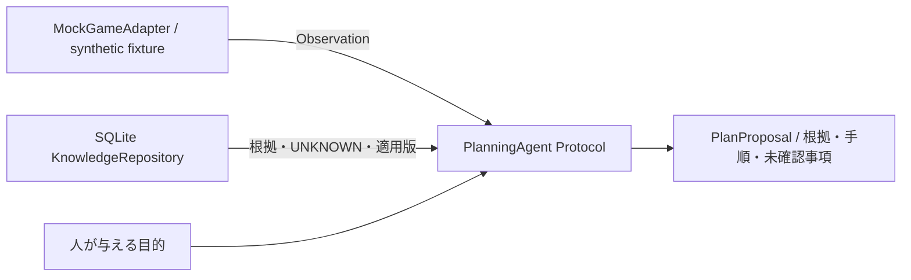

# アダプタ・AI設計と次Phase計画

Phase 0時点では実ゲームへ接続せず、AIモデルも呼び出しません。将来のONI観測層とAI判断層の境界を、Python Protocolと不変のデータクラスで定義します。

## インターフェース

実装：[interfaces.py](../src/oni_ai/interfaces.py)、[adapters.py](../src/oni_ai/adapters.py)。

| 境界 | 現在の契約 | 将来の実装要件 |
| --- | --- | --- |
| ReadOnlyGameAdapter | read_resource(uri) -> Observation | 実行口と別権限、監査済みURI/引数のallowlist |
| Observation | resource_uri、payload_json、observed_at、game_version、dlc_scope、context_id、provenance | セーブ/世界/観測時点を関連づけ、版不明や鮮度不明を保持 |
| KnowledgeSearch | search(query, game_version, dlc_scope, limit) | AIへ根拠とstatusを保持した結果を返す |
| PlanningAgent | propose(objective, observations, knowledge) -> PlanProposal | 判断・計画・改善はAI自身に任せる |
| PlanProposal | objective、observation_context、rationale、steps、unknowns | 実行権限を含まない提案データ |

現在のMockGameAdapterはメモリ内のfixtureを深いコピーで保持し、manifest/status/defsの完全一致URIだけを受け付けます。URI queryやHTTP URLを拒否します。数値を実測したように見せず、provenanceにMOCK_SYNTHETIC_NOT_GAME_DATA、時刻・版・DLCにUNKNOWNを付けます。manifest fixtureもOniMcp実行時manifestの実物ではありません。

実行メソッドはありません。将来の変更操作はReadOnlyGameAdapterに追加せず、別ActionExecutorと承認済み操作データで設計します。単なるconfirm=trueを人間の承認の代わりにしません。

## Phase 1：オフラインで進める推奨範囲

| 順序 | 実装作業 | 完了条件 |
| --- | --- | --- |
| 1 | 根拠のある設備情報を少数ずつ追加、配列内の単位・型・出典validatorを実装 | 版/DLCと検証状態が揃い、例示値や推測を取り込まない |
| 2 | 固定ソースのMCP応答形式を合成fixtureでモデル化 | initialize/session、manifest、resource、エラーをオフラインで再現 |
| 3 | JSON-RPCのcodecと互換性検証をtransportから分離して実装 | 2025-11-25のみ既知扱い、未知版/欠落/改名は停止またはUNKNOWN |
| 4 | 計画提案を保存・比較する評価ループ | 観測と根拠を追跡し、UNKNOWN無視や架空の資源利用を検出 |
| 5 | 規約・権利確認のための具体的な利用方式と問い合わせ文案を整理 | 送信せずレビュー可能な文案・判断材料がある |

ゲームルール・操作仕様・設備仕様を事実層として与え、攻略方針や固定の建設順は正解として与えません。評価は与えられた観測に対する整合性、根拠使用、未確認事項の明示、計画の改善可能性を測ります。モデルAPIを使う段階では、ユーザーが選ぶ提供元・費用・データ送信範囲を決め、秘密情報を環境変数へ隔離します。

Phase 1ではmock継続が可能です。実ネットワーク接続やゲーム設定変更はこの計画の実施に必須ではありません。

## 将来の接続Phaseへの入口

実ゲーム接続は、[適用条件](terms_review.md)の確認と必要な許諾、ユーザーによる明示承認の後にのみ検討します。その時点で以下を具体化します。

1. 目的に適したゲームビルド・DLC・OniMcpコミット・配布物ハッシュを選定。MOD起動時の自動消毒/通知等の副作用を確認する。
2. 承認された検証用環境と新規テストセーブ、バックアップと復元手順を用意。既存セーブを対象にしない。
3. loopback限定の観測専用transportを実装。認証・応答サイズ・タイムアウト・エラー・ログの秘密情報除去を設計し、公開サーバーを作らない。
4. 実行時のinitialize応答、tools/list、resources/list、manifestを記録し、固定コードとの差を比較。未知の版・アクション・型を黙って受け入れない。
5. 読み取りURIを個別監査し、更新やUI操作を起こす経路、任意のresource query、generic tool routingを許可しない。
6. 観測データのGAME_VERIFIED化は、ゲーム版・DLC・時刻・セーブ文脈と根拠を保存してから行う。

操作を許可するさらに後のPhaseでは、提案と実行を分け、対象・期待差分・資源上限・承認の有効期限を持つ承認記録、dryRun、明示確認、再読照合、緊急停止、重複実行防止を用意します。批次の部分成功とセーブ切替を扱い、大量の自律操作へ直結させません。

## 未確認事項

- Steamの広いAutomation禁止に対する本研究の許諾、Klei側の個別適用。
- 固定ソースとWorkshop等の配布DLLの対応、READMEのプロトコル説明差異の解消状況。
- ONIの実ビルド、DLC、他MODの組合せ互換性。
- 設備の用途・資材量・消費/生成電力・入出力・温度制限・研究前提の実値。
- 接続、パフォーマンス、非同期処理、UI、ゲーム副作用の実測。
- AIモデル・評価指標の具体化、利用料金、API契約、データ送信範囲。
- 独自コードを将来公開する際のライセンス選択（Phase 0では未選択）。

Phase 0ではこれらを推定で解決せず、文書とUNKNOWNとして引き継ぎます。
