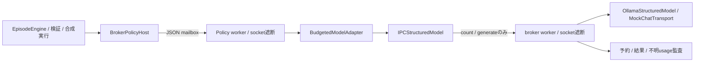

# Phase 4B1：オフライン推論IPCと比較v2

2026-11-06、版0.4.0b1。変更理由は[実装判断](phase4b1_decisions.md)、結果は[検証記録](phase4b1_validation.md)。モデル、tokenizer、追加runtimeを取得せず、HTTP/LLM APIを一度も呼び出さないmock実装です。

## 境界と互換性

StructuredModel Protocol、ModelReply、Policy、EpisodeEngine、Phase 1/2/3ログを変更しません。既存BudgetedModelAdapterには明示的retryable=Falseの例外を再試行しない処理だけを追加しました。既存の一般例外は従来どおり上限まで再試行します。旧policy_process.py・比較v1・DBスキーマ・設備知識は変更していません。

親が同じPythonの固定moduleを`-I`で起動します。roleはpolicy/brokerのみで、任意command、module、URLをRPCで指定できません。子はSYSTEMROOT/WINDIR/SYSTEMDRIVE/TEMP/TMPとPython実行ディレクトリだけのPATHを受け取り、APIキー等を含む親の環境を起動前に除外します。両workerでsocket生成・接続・名前解決を遮断します。これは信頼済みコード向けの境界であり、悪意あるPythonコード・ネイティブ拡張・同一OSユーザーを隔離するsandboxではありません。

IPCは親所有の一時ディレクトリ内の単一要求・応答mailboxです。UTF8 JSONのサイズは1,000,000 bytes、監査は20,000,000 bytesまで。fsync後の置換で公開し、Windowsの一時的PermissionErrorだけを期限内で再試行します。親が単調時計で期限を監視し、失敗時はPolicyとbrokerをterminate、必要ならkill、waitし、一時領域削除まで確認します。同期transport自体の前後時刻検査は強制中断ではなく、強制停止はこの親プロセス境界の責任です。予期しない親PCの電源断からの自動復旧は実装していません。

## モデル契約・正確な計数

実装は[local_model.py](../src/oni_ai/local_model.py)、[inference_contracts.py](../src/oni_ai/inference_contracts.py)。OllamaStructuredModelは注入されたtransportだけを使用し、HTTP clientや接続URLを持ちません。model、messages、format(schema)、stream=False、think=False、options.num_predictを組み立てます。応答のモデル一致、done=True、done_reason=stop、assistantのcontent/thinking、usageを検査し、tool呼び出し等の未対応形式を拒否します。

CounterBindingはmodel_id/tokenizer_revision/template_revisionの組合せを照合します。現在の唯一の対応はoffline-byte-model/v1・mock-utf8-byte/1・mock-chat/1で、JSON schemaとchat wrapperを含む正確なUTF8 byte数を人工tokenとします。実LLMのtoken数の近似ではありません。unconfigured-localはモデル候補名だけを持ち、tokenizer/templateがUNKNOWNのためEXACT_COUNTER_UNAVAILABLEでtransport呼出し前に停止します。実モデルのspecial tokens・template・schema注入・thinking・context切捨ての計数はB2で校正が必要です。

mock出力usageはcontentとthinkingのUTF8 byte合計、入力usageはcountと完全一致を要求します。欠落、bool、負数、過大、別モデル、部分出力を受け入れません。実モデルでこのbyte照合を再利用してはいけません。profileの人工価格は入力1,000,000／出力2,000,000 microUSD/百万mock tokensで、予算算術のテスト値です。実料金・課金・電力費を表しません。

## 予約、重複、失敗

brokerはcount要求のpayload/schema/countを結び付けたticketを返し、generateでは同じpayloadと一回限りのticketを要求します。モデルkeyは閉じたregistryです。実モデルkeyは比較v2から選択できません。

各生成の前に、入力＋最大出力、端数切上げした最大mock費用をadapterとbrokerの両方で予約します。brokerは予約イベントを原子的ファイルとして保存してからtransportへ進みます。成功時も予約を返金せず、検証できた実usageを別に保持します。失敗・強制終了・応答未確認はusage_unknown_requests、予約後結果なしはincomplete_requestsとして区別します。予約なしの生成や予算不足時のtransport実行は許しません。

同一ID・同一内容の再送はキャッシュ応答で、再生成・追加予約しません。同一ID・異なる内容は拒否、使用済ticketは別IDでも拒否します。キャッシュはそのbroker寿命内のみ有効です。異常終了後の自動再起動・再送は行いません。永続的なexactly-once推論や課金照合を保証するものではありません。

再試行はModelLimits.attempts以下（既定2）、かつ時間・累積予算内だけです。接続失敗・不正JSON・部分出力・構造化出力不一致等は限定的に再試行可能とし、未知counter、usage違反、秘密情報、予算違反等は停止します。例外本文やtracebackをworker出力へ保存せず固定コードに変換します。

## schema、根拠、UNKNOWN

JSONは重複key・NaN等を拒否します。独自の小さいschema subset（object/array/string/number/integer/boolean/null、properties、required、additionalProperties=False、items、anyOf、enum、const、長さ/数値境界）を事前検証し、未対応keyword・循環・深すぎる構造・巨大schemaを拒否します。完全なJSON Schema実装でも、各runtimeの対応保証でもありません。

取得した知識から今回許可するactionとclaims schemaを構築し、応答をschema検査した後、既存validate_envelopeで根拠ID・実際の主張値/status・適用範囲・UNKNOWN・観測context/tick/digestを照合します。根拠の存在だけで正当化しません。資源・操作可能性・反復・進展・実行予算は引き続きEpisodeEngineが検査します。自由文の理由の意味を完全理解したとは主張しません。

既知のAPI/private-key形式、credential URL、秘密key名、個人Windowsパス等を入出力・監査への書込み前に拒否します。固定パターンの検出であり、すべての秘密文字列を検出するDLPではありません。入力自体に機密情報を入れず、生成物はGit対象外にします。テストの秘密文字列は架空のcanaryで、実キーは作成していません。

## 比較plan/report v2と再現

比較v1の定数やseedは上書きしません。[model_comparison.py](../src/oni_ai/model_comparison.py)と新CLIがcomparison-plan/2・comparison-report/2を生成します。mock-development（4001/4003）、mock-validation（5003/5009）、Policy seed 0/1、exploration/lookahead/model-mockを同じfixture・観測・操作予算・step上限で比較します。model-mockは探索Policyを返すtest doubleです。fixture名・評価seedをPolicyへ渡しません。開発reportとソース・設定を固定してからvalidationを開きます。

studyのtoken/費用上限を両groupで共有し、残予算を次groupに引き継ぎます。各エピソードでもbroker/adapter上限を適用します。root planにsnapshot・ソースhash・各予算・seed・B2の未実行案を記録します。JSON/CSV/Markdownに従来の独立指標と推論予約・検証済usage・不明usage・停止理由を保持します。

旧research JSONLは変更せず、内容digestでmodel-audit/1 sidecarと結びます。replayは合成遷移を再計算し、sidecarの入力context/履歴/取得根拠が各stepと同一であること、count・予約・usage・最終提案を照合します。reportの条件・組合せ・予算持越し・集約・CSV/Markdownも再検証します。Policyやtransportは再呼出ししません。タイムアウトの実時間・プロセス停止・削除成功はテストで確認し、replayでは記録された事象として扱います。hashは自己整合性検査であり、署名による第三者改竄防止ではありません。

## B2への境界

B1の検証seedは接続テスト用に公開された回帰条件です。B2用seed/新条件は設計のみで生成・実行していません。実モデルの比較性能・応答速度・RAM/VRAM適合性はすべてUNKNOWNです。[B2引継ぎ](phase4b2_handoff.md)の正確な計数、固定接続先、容量/ライセンス、測定と停止のgateを満たしてから導入します。

参照（2026-11-06、公式仕様の確認のみ）：[Ollama chat API](https://docs.ollama.com/api/chat)、[Structured outputs](https://docs.ollama.com/capabilities/structured-outputs)。schema対応は実runtime/モデル版でB2に再確認します。
