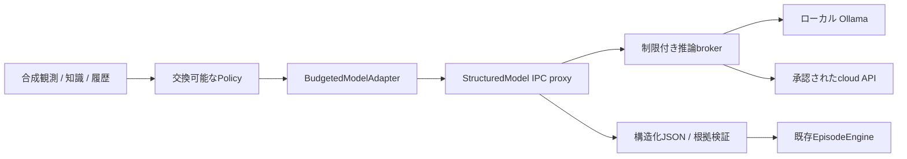

# Phase 4B：接続・最小実験の具体案

策定日：2026-11-02（Asia/Tokyo）。本書は**次Phaseの設計**です。モデル取得、runtime導入、キー設定、API課金、ローカルモデルサービス起動を今回許可・実施するものではありません。Phase 4Aではソースコードと依存を変更していません。

## 推奨構成とA/B/C比較

| 構成 | PC適合性・判断能力 | 工数・費用・運用 | 判断 |
| --- | --- | --- | --- |
| A ローカルのみ | RTX4060/8GBでQwen3.5-4B Q4_K_Mの短contextを条件付き試験。判断品質/速度はUNKNOWN | runtime導入・版固定・ピークRAM/VRAM測定が必要。API課金0だが電力/保守費はUNKNOWN | **最初の最小実験に推奨**。送信/課金を増やさず観測→判断の配線を検証できる |
| B クラウドのみ | ローカル推論GPUを要しない。GPT-6.1 Sol等を品質参照にできるが実性能はUNKNOWN | 単一API接続は比較的少ない運用要素。送信許可、鍵、実請求式、レート制限と継続費用が必要 | ローカルが不適合/工数過大なら選択肢。安価なLunaだけで能力不足を一般化しない |
| C 併用 | ローカルと品質参照の別々の比較、後に必要ならrouting | 二系統の版・予算・ログ・障害を管理するため初期工数が最大 | **段階導入の到達案**。まず独立比較し、混合による効果を別実験で評価 |

選定：Aの**Qwen3.5-4B/Q4_K_M＋Ollama**を第一候補、現メモリでは不合格ならQwen3.5-2B等の適切な量子化配布を再選定します。cloudが別途承認された場合は**GPT-6.1 Sol**を参照Policy、**GPT-6 Luna**を低費用対照とします。資料だけで「最も賢いONIモデル」を確定しません。hardwareの詳細は[PC報告](phase4a_pc_environment.md)、選定根拠は[ローカル](phase4a_local_models.md)・[クラウド/費用](phase4a_cloud_models.md)にあります。

メモリ不足なら自動でcloudへ送る設計にしません。将来のroutingは、検証失敗・不確実性・承認された予算等の一般条件に基づく別Policyとし、酸素不足ならcloud等の攻略正解表を持たせません。routing自体の費用・失敗も数えます。

## 既存境界との接続

使用する契約は[Policy](../src/oni_ai/policy.py)、[BudgetedModelAdapter / StructuredModel](../src/oni_ai/model_adapter.py)、[根拠validator](../src/oni_ai/research_boundary.py)、[比較基盤](../src/oni_ai/comparison.py)です。StructuredModelのcount_tokens/complete、ModelReplyのtext/input_tokens/output_tokensを維持する方針です。localの価格は明示的に「API従量課金0」と設定できますが、電力費が0という意味にはしません。

Policy交換は、許可されたfactory registryのexploration/lookahead/llm-local/llm-cloudを設定で選び、LLM用はBudgetedModelAdapterへ固定したStructuredModel proxyを注入する方式とします。任意のimport文字列やモデル生成コードを実行する入口は追加しません。現行比較v1はPOLICY_NAMES/GROUPSを固定検証するため、それを直接書き換えると旧report検証を壊します。**Phase 4Bには新しいplan/report v2とCLI経路**を追加し、旧v1定数・seed・ログ・replayを残します。共通Engine/指標計算を再利用し、LLM固有のcall監査だけをsidecarに分離する方針です。

### 入力・出力

- 入力：匿名化観測のcontext/tick/digest、目標、検索された有限個のmodel/DB根拠（値・status・版・出典）、UNKNOWN、直近の行動・結果・失敗。fixture名・split・環境seed・正解表は渡さない。
- 最小出力：現行research envelopeのproposal＋claims。行動内容、簡潔な理由、参照ID、未確認事項を必須とし、検証後の次の1行動だけを実行する。ツールやshellをLLMの指示で直接起動しない。
- schema：現行Python validatorを最終判定とし、各providerのJSON Schema subsetへ変換する。可変のclaim.valueは取得済み根拠のshapeから有限の型/ID/status候補を作り、root anyOfや自由なadditionalProperties等の非対応部分をmockで先に検出する。複雑すぎるschemaは呼出し前に停止し、無制約JSONへ黙ってfallbackしない。
- claimsの値やstatusの不一致、UNKNOWNの既知化、context/tick/digest不一致、根拠欠落、資源不足は拒否し、自由記述を理由に許可しない。JSON拒否・refusal・途中出力も失敗として残す。

構造化計画の拡張案はPlanDraft（plan_id、revision、objective、根拠付きassumptions、milestones〔予想観測/完了/停止条件〕、revision_reason、残予算）です。これらはモデル自身が作る外向きの計画データで、内部思考の開示を求めません。長期計画を追加する場合は新wire契約のplan_recordに保存し、正規化後のModelReply.textには検証対象の既存envelopeだけを渡します。planは監査sidecarに紐付け、既存rootへ未知fieldを混入させず、全計画を自動実行もしません。raw応答のサイズ・token費用は切り出し前に計上します。最小比較ではまず1行動の契約を通し、長期計画の有無を後続の別実験にします。

観測の文字数は実ログで約1,249〜1,433、Decisionは約1,978〜2,310文字でした。これはtoken数でも全prompt量でもありません。現在の16件履歴と32件以上の背景factsを丸ごと送ると、小さいcontextや出力上限を超える可能性があります。共通の入力整形器で直近2件＋失敗要約、関連する少数の根拠を選び、選別/除外とUNKNOWN一覧を記録します。比較対象Policyにも同じ観測範囲・知識検索権限・共通履歴窓を適用します。確定していない仕様を要約時に補完しません。

### ローカルとcloudのtransport

| 実装候補 | 想定mapping | 実装前の確認 |
| --- | --- | --- |
| OllamaStructuredModel | 許可したloopbackのchat endpoint、schema format、非stream応答、content/usageをModelReplyへ変換 | tag/full digest固定、text-only/num_ctx、thinkingの内容と計数、tokenizer/計数経路、キャンセル/モデル解放 |
| OpenAIStructuredModel | Responses、schema、出力上限、reasoning設定、store=false。usageを課金カテゴリ込みで計上 | モデル固有の対応schema・tokenizer/ラッパー分・実請求式。built-in tools/MCP/検索は無効 |
| その他provider | MessagesまたはgenerateContentの構造/usageへ明示mapping | 同じ「OpenAI互換」という名前だけでpayload/usage/保存条件が一致すると見なさない |

**重要な現状差分**：既存[ProcessPolicy](../src/oni_ai/policy_process.py)のworkerはsocketを遮断するため、そのままSDKを呼ぶことはできません。遮断を一括解除せず、信頼済みの別brokerにだけ許可したlocal endpointまたはcloud originを与え、Policy側はJSONのIPC proxyを使う設計とします。brokerはモデル・宛先・サイズ・期限・予約台帳・request IDを検査し、任意URL、redirect、任意ツールへの転送を拒否します。

spawnは通常親の環境を継承するため、単に「キーは親環境変数にある」とするだけでは子への隔離になりません。実装時は明示allowlist環境で起動するworker/broker分離などを選び、Policyプロセス・入力JSON・一時ファイル・ログにキーが入らないことをmock鍵で検証します。キー作成/設定は今回行っていません。

count_tokensはUTF8長/4のような推定で確定しません。正しいtokenizerとchat/schema wrapper分、または明示承認された計数経路が必要です。Ollama等の採用版で生成なしの正確な計数経路が確保できるかは**UNKNOWN**で、初回生成を有効にする前の実装ゲートです。未対応なら対応版/別runtimeを選ぶか、検証済みの上界予約方式を明示設計します。

## 予算・異常・記録

現状のModelLimitsは入力8K/出力2K、累積20K tokens/$0.10、1提案最大2試行/10秒です。reserved_tokens/costはアダプタの存続中累積し、secondsは提案ごとの期限です。ProcessBudgetは1呼出し2秒/全体60秒であり、そのまま実LLMに流用しません。

Phase 4Bでは次を別々に設けます。

1. **要求単位**：local初回案はcontext4,096、入力最大2,048、出力/思考最大1,024。schema/chat templateの余裕を取り、溢れる入力は整形するか停止。cloudのM/L費用シナリオとは区別する。
2. **episode/実験単位**：最大steps20、retry上限2、各生成の最大token/費用を前予約。アダプタの20K既定で長いepisodeが動くと仮定しない。例えば上記local案の20steps×2試行は最大122,880 tokens相当で、実行許可時の予算として明示する。実験全体にも共通台帳を置く。
3. **時間**：開発だけで遅延を校正し、共通の上限案は呼出し60秒・episode300秒、起動/ロードは別に測定・固定する。既存ProcessBudgetの上限範囲を守る。20行動まで到達する前に時間上限で止まる可能性を隠さず、timeout/打切り件数を別記する。評価後に期限を緩めて再評価しない。
4. **cloud費用**：最初は例えば100判断/$10の独立した候補枠を利用者へ提示するが、未承認。SolでMの1判断は$0.031、100判断$3.10、同程度の2試行なら概算$6.20。実際の最大予約は指定した最大出力と実入力に基づく。料金・reasoning使用・retryを数え、上限到達で追加要求を止める。

予約は失敗/timeoutでも自動返金せず、使用量不明ならUNKNOWNと最大予約を保持します。providerが後から課金する可能性と取消不能を考慮し、usageや請求式が予約を超えたら停止して照合します。現コードだけで実請求の厳密な上限を保証するとは主張しません。

retryはtransportの一時エラーや構造修復の範囲に限定し、予算・全体期限内で行います。不正な秘密情報を含むerror本文はpromptへ戻さず、分類したコードだけを渡します。古い観測での再要求は同じrequest IDで重複を抑え、状態更新後は再観測します。失敗を固定のゲーム行動へ置換しません。

call監査にはmodel/version/量子化/runtime/backend、prompt/schema/tokenizer digest、sampling/thinking設定、予約/実usage/cost、遅延、retry、finish reason、検証結果を記録します。課金出力にreasoningを含めても、非公開の内部思考を保存/要求する必要はありません。評価ログは新version/sidecarとして追加し、Phase 1〜3形式を壊しません。生成ログは引き続きGit対象外です。

## 開発・評価の手順

| 段階 | 作業 | 合格条件 |
| --- | --- | --- |
| 0 | モデル/完全hash/ライセンス/runtime/backend・取得量・保存先・送信/費用の範囲を決める | 利用者の必要な承認が明確。未承認APIや自動cloud fallbackなし |
| 1 | broker、token計数、schema変換、usage/予約、環境鍵除去のmock実装 | 不正JSON、refusal、oversize、429/5xx、切断、usage欠落、過請求、deadline、後始末・重複の検査がPASS |
| 2 | 承認されたlocal環境で小さい開発入力の校正 | 実VRAM/RAM・cold/warm遅延・token/s、日英のJSON/指示追従を記録。OOM時は停止し条件を再選定 |
| 3 | 同条件でexploration / lookahead / LLMを比較 | 固定攻略順なし、匿名化・根拠・UNKNOWNを保持。prompt/量子化/thinkingの調整は開発だけ |
| 4 | 新しい保留条件を封印して実行 | 設定/ソース/prompt/schema/model digestを固定、同じ初期状態/操作/step/情報で比較、全ログ再現 |

新seed案（**今回は列挙だけ。fixture生成・実行なし**）：開発1103,1201,1301,1409、保留2101,2203,2309,2411,2503,2609,2707,2801。Phase 3の0,1,2,17,42,101と203,307,409,503,607,709,811,907、比較単体テスト1000/2000/3000とは重複しません。Phase 4B開始時にseedだけでなく未使用の資源/障害/研究・UNKNOWNの組合せも開発と分離して事前登録します。既公開のPhase 3評価は回帰用です。

最小のlocal比較案は、4開発環境×Policy seed2種（0,1）×3 Policy＝24episode、その後8保留環境×2×3＝48episode、各最大20steps。同じ情報予算・操作上限・同じ最大時間を全Policyに提供します。local LLMは最大160+320=480判断、2試行なら最大960生成要求ですが、上限まで必ず使うものではありません。cloudはこれに自動追加せず、独立の承認済み小規模対照として設計します。

目標達成、需要proxy、資源消費/残量、無効率、停滞、失敗後の変更、UNKNOWN、wall時間/打切り、token/costを独立に評価します。環境seedを単位とするペア差、分布/欠損数を報告し、timeout例を都合よく除外した達成率だけを示しません。実LLMはseed指定があっても完全に同じ提案を出すとは限らないため、保存済み提案の遷移replayとモデル再実行の再現性を分けます。

## 長期計画・記憶への拡張

将来はLLM自身が作るサブゴール、前提、予想差分、検証条件、残予算をversion付きの計画データとして保存し、観測差分/失敗から改訂させます。長期記憶は「観測事実」「モデルが述べた仮説」「反証された試行」を分離し、根拠ID・版・時点・UNKNOWNを保持します。要約をGAME_VERIFIEDな知識へ自動登録しません。古いdigestに結び付いた実行提案は再利用せず、毎回検証します。攻略順や危機別の正解表は人が埋め込みません。

未確定：実速度・メモリ・日英の判断精度、正確なtoken計数、選定artifactの完全hash、アカウントquota・保存条件、実費用上限、brokerのOS隔離とモデルサービスの停止/解放。これらを確認してからPhase 4Bの実装範囲を確定します。実ゲームはPhase 4Bでも接続しません。
